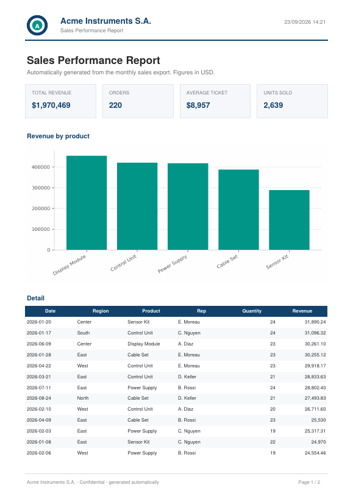

# Excel to PDF Report Generator

Turn any Excel or CSV export into a branded, client-ready PDF report — letterhead, KPI cards, charts and formatted tables — with a single command.

Built for teams that still assemble monthly reports by hand: copy data into a template, paste a chart, export to PDF, repeat. This tool does the whole thing in seconds, and the layout is driven by a YAML config file, so adding a new client or a new report means writing a config, not new code.



## Features

- **Reads what you already have** — `.xlsx`, `.xlsm`, `.xls` or `.csv`.
- **Branded letterhead** on every page: logo, company name, document title, date, and a footer with page numbering.
- **KPI cards** with configurable aggregations (`sum`, `mean`, `count`, `min`, `max`, `median`, `nunique`) and number formats.
- **Charts** (vertical bar, horizontal bar, line) generated with Matplotlib and coloured to match the brand.
- **Data tables** with custom column selection, renamed headers, sorting, row limits, zebra striping and automatic page breaks that repeat the header row.
- **Config-driven** — one YAML file per report type. No code changes to onboard a new client.
- **No manual steps** — a single command, easy to run on a schedule (cron, Task Scheduler) or from another script.

## Quick start

```bash
git clone https://github.com/NorbertoCabrera/excel-to-pdf-reports.git
cd excel-to-pdf-reports
pip install -r requirements.txt

# Generate the fictional sample dataset
python examples/make_sample_data.py

# Build the report
python -m report_generator \
    --data examples/sample_sales.xlsx \
    --config examples/config_sales.yaml \
    --output output/report.pdf
```

The result is [`examples/sample_report.pdf`](examples/sample_report.pdf).

### Command line options

| Option | Required | Description |
| --- | --- | --- |
| `--data` | yes | Input file: `.xlsx`, `.xlsm`, `.xls` or `.csv` |
| `--config` | yes | YAML file describing branding, KPIs, chart and table |
| `--output` | no | Output path (default `output/report.pdf`) |
| `--sheet` | no | Sheet name or index for Excel files (default: first sheet) |

## Configuration

Everything visual lives in the YAML file — see [`examples/config_sales.yaml`](examples/config_sales.yaml).

```yaml
branding:
  company_name: "Acme Instruments S.A."
  document_title: "Sales Performance Report"
  subtitle: "Automatically generated from the monthly sales export."
  logo_path: "assets/logo.png"     # optional
  footer_text: "Confidential"
  primary_color: "#11426C"
  accent_color: "#009688"

kpis:
  - label: "Total revenue"
    column: "Revenue"
    aggregation: sum
    number_format: "${:,.0f}"

chart:
  title: "Revenue by product"
  kind: bar                        # bar | barh | line
  group_by: "Product"
  value_column: "Revenue"
  aggregation: sum
  top_n: 10

table:
  columns: ["Date", "Region", "Product", "Quantity", "Revenue"]
  headers:
    Sales Rep: "Rep"
  sort_by: "Revenue"
  sort_desc: true
  max_rows: 40
```

Sections are optional: drop `chart` or `table` and that block is skipped. Leave `logo_path` empty for a text-only letterhead.

## Project structure

```
report_generator/
├── config.py        # YAML parsing into typed dataclasses
├── data.py          # loading, KPI aggregation, chart series, table selection
├── chart.py         # Matplotlib rendering to PNG
├── pdf_builder.py   # fpdf2 layout: letterhead, KPI cards, chart, table
└── cli.py           # command line entry point
examples/            # sample dataset, sample config, sample output
assets/              # logo used by the sample letterhead
```

## Built with

Python 3.10+, [fpdf2](https://github.com/py-pdf/fpdf2), pandas, openpyxl, Matplotlib and PyYAML.

## Roadmap

- Multi-section reports (one chart + table block per group)
- Excel and HTML output alongside PDF
- Email delivery and scheduled runs
- Optional cover page and table of contents

---

## Español

Convierte cualquier exportación de Excel o CSV en un informe PDF con membrete, tarjetas de indicadores, gráficos y tablas formateadas, con un solo comando. Todo el diseño se define en un archivo YAML, así que sumar un cliente nuevo es escribir una configuración, no código.

```bash
pip install -r requirements.txt
python examples/make_sample_data.py
python -m report_generator --data examples/sample_sales.xlsx --config examples/config_sales.yaml --output output/informe.pdf
```

## License

MIT — see [LICENSE](LICENSE).
